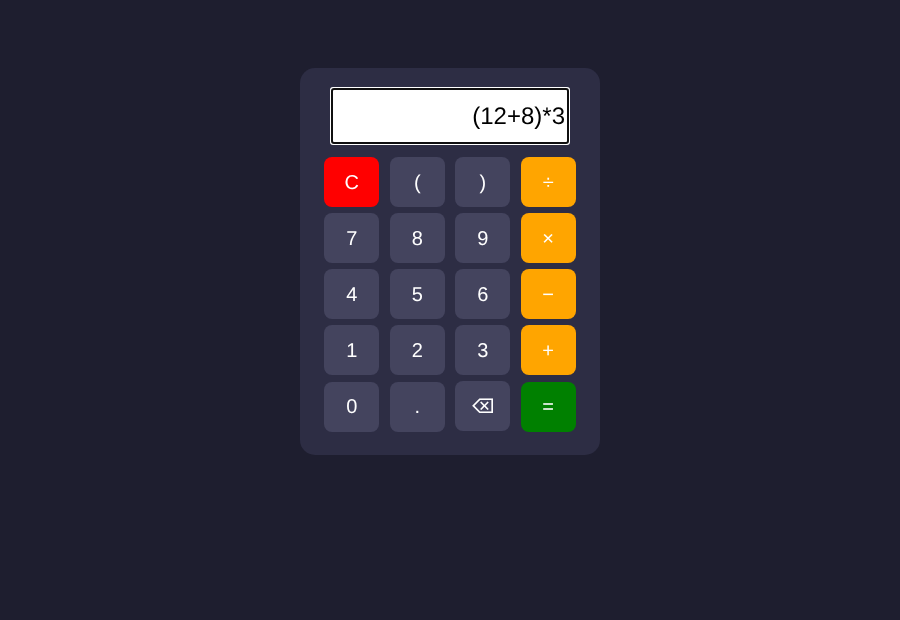

# Калькулятор

Простой калькулятор в браузере: сложение, вычитание, умножение, деление и скобки.

Демо: https://mustafamashhady2.github.io/calculator/

## Задача
Сделать калькулятор, который открывается в браузере и не требует установки.

## Что сделано
- экран и кнопки на HTML, оформление на CSS
- функции на JavaScript: ввод символа, очистка, удаление последнего символа, вычисление
- если выражение написано неправильно, выводится «Ошибка»

## Как делал
Сначала расположил кнопки, потом написал функции. В конце проверил на разных примерах, в том числе с ошибками.

## Инструменты
HTML, CSS, JavaScript

## Контекст
Учебный проект, делал один.
